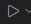
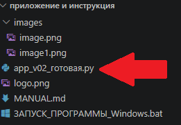
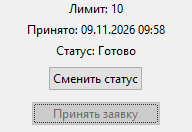
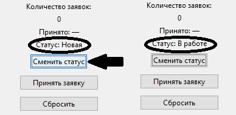
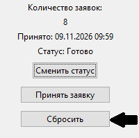
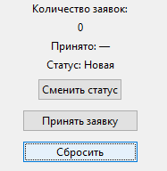
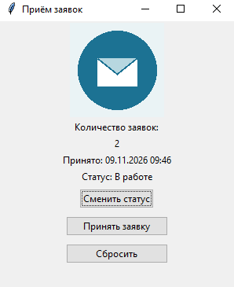

# Приём заявок

Автор: [Пыжов Дмитрий Андреевич]  
Группа: [ТЭС11-26]  
Версия программы: [0.2.1]

## Назначение
Программа была написана для заказчика, чтобы решить задачу со статусом заявок.

## Запуск
Перенесите все файлы в отдельную папку (название папки может быть любым). После этого откройте эту папку в VS Code. Затем нажмите на "app_v02_готовая.py. Затем нажмите на кнопку , которая находится в правом верхнем углу. Второй способ: откройте файл "ЗАПУСК_ПРОГРАММЫ_Windows.bat.

## Приём заявки
1. Нажмите на кнопку "Принять заявку". После этого количество заявок увеличится на 1. Также программа покажет время, когда была принята заявка.
2. Проверьте количество заявок. Если будет 10 заявок, то кнопка "Принять заявку" заблокируется.

## Смена статуса
Нажмите на кнопку "Сменить статус". После этого статус сменится на "В работе", если до этого был статус "Новая". Если был статус "В работе", то статус сменится на "Готово". Если был статус "Готово", то статус сменится на "Новая"

## Сброс счётчика
Нажмите на кнопку "Сбросить". После этого количество заявок станет нулевым. Если нажать на эту кнопку тогда, когда заявок нет, то ничего не произойдёт.

## Скриншот

## Если возникло затруднение
- Ситуация 1: программа не открывается в VS Code. Решение: откройте bat-файл.
- Ситуация 2: картинка не отображается. Решение: вероятно, вы не переместили картинку в папку. Скопируйте в папку все файлы.

## Результат проверки
Проверяющий: [ФИО]

[Какие действия выполнены по мануалу? Что получилось? Где возник вопрос? Проверили ли изображение?]

## Доработка
[Что изменили и как перепроверили. Если правки не понадобились, обоснуйте это результатами проверки.]
